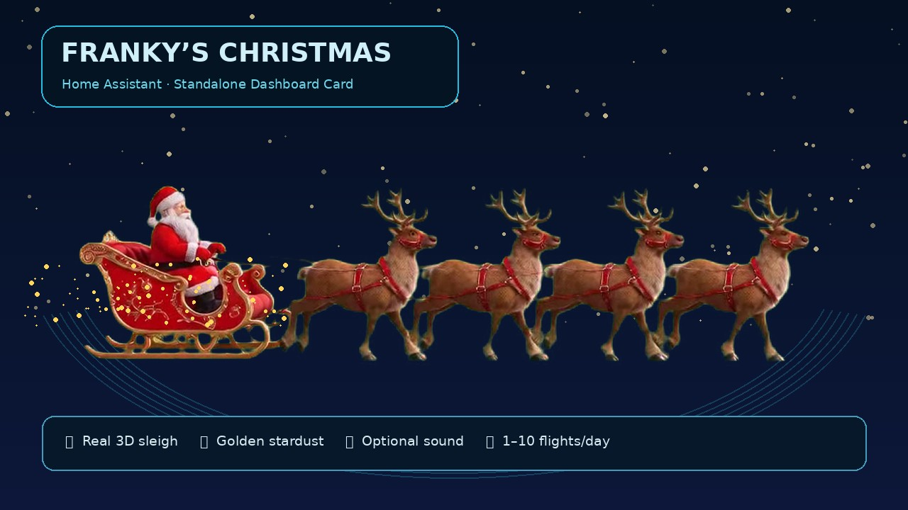

# Franky's Seasonal Fun Card

**Formerly Franky's Christmas Card.** Seasonal overlay animations for Home Assistant dashboards. Christmas, Halloween, St. Martin and a St. Nicholas scene with synchronized sound share one schedule and a compact customizable control card.



## Existing Christmas Card users — important

**This is an update to the same HACS repository. Do not uninstall Christmas Card or add a second repository.**

The repository address and HACS resource filename remain unchanged. Existing cards using `type: custom:frankys-christmas-card` continue to work and open the new controls. The default season is Christmas. Existing per-browser settings are migrated when they are still available. A one-time bilingual notice explains the rename.

If you previously installed a separate Seasonal beta resource under `/local/frankys-seasonal/`, remove that *separate beta resource* before using the HACS release to avoid duplicate schedulers.

## New installation

In HACS, add **Dashboard** custom repository `https://github.com/Franz1302/frankys-stuff-christmas-card` and install **Franky's Seasonal Fun Card**.

Add a card:

```yaml
type: custom:frankys-seasonal-card
```

The repository URL retains the original `christmas-card` slug for safe upgrades.

## Version 0.4.1

This release adds the annual calendar, St. Martin and St. Nicholas animations with synchronized Mirelo sound. **All calendar edits made in the card are stored per browser** (not synced between displays). Audio generated on the Mirelo Free Plan is for non-commercial use only and must visibly credit Mirelo; code remains MIT, third-party media has separate terms. See [media attribution and restrictions](SEASONAL_ASSET_SOURCES.md).

## Features

- **Season** button: manual Christmas, Halloween, St. Martin or St. Nicholas selection; the manual choice overrides the holiday calendar for the current date.
- Christmas: original Santa sleigh, bell sounds, transparent WebM and iPad/Safari WebP.
- Halloween: animated 3D marshmallow with walking, turning and bursting into smaller marshmallows, plus individual sounds.
- St. Martin: transparent animated WebP scene (`dist/assets/St_Martin_korrigiert.webp`) and synchronized Mirelo sound (`dist/assets/St_Martin_Mirelo_Ton_9s.mp3`), trimmed to the animation's 9.25-second duration. Sound follows the existing on/off switch; image, sound path and volume can be overridden in the visual editor.
- Optional annual holiday calendar, accessible directly in **Options → Annual calendar** in the card, or configurable in the visual editor/YAML. Enable/disable each holiday and configure inclusive yearly `MM-DD` date ranges, including ranges across New Year. On overlaps, priority is Halloween, St. Martin, St. Nicholas, then Christmas.
- St. Nicholas: 15-second transparent cartoon animation with two donkeys and a synchronized Mirelo sound-effects track (`dist/assets/Nikolaus_ohne_Wasserzeichen_transparent.webp` and `dist/assets/Nikolaus_Mirelo_Ton_15s.mp3`). The soundtrack follows the card's sound toggle; the visual editor allows optional custom media paths and a volume override. A missing file displays a notice and does not affect other scenes.
- Shared local schedule: 1–10 random appearances/day, hourly, 1–2 / 3–8 / 5–10 / 10–20 minute patterns and user-defined minute interval, all within configurable start/end times.
- Enable, Sound, Test and Stop buttons; extra settings under **Options**.
- Visual editor with custom colors, opacity, rounding and optional scoped CSS.
- German/English language chosen automatically from Home Assistant (English fallback).
- Fully local runtime: Three.js r180 and GLTFLoader included; no CDN calls or cloud dependency.
- Each browser/display has independent settings and schedule. No HA automations or Browser Mod required.

**Playback compatibility:** WebGL is required for Halloween; browser autoplay policies may require an initial interaction to unlock sound, especially on Silk and Safari.

## HACS and manual setup

The HACS entry deliberately stays `dist/frankys-christmas-card.js` to preserve automatic updates. The old YAML type is preserved as an alias. HACS distributes all supporting files from `dist/`, including `vendor/`, `assets/` and the original Christmas media.

Manual installations must copy all of `dist/` into one web directory and register its `frankys-christmas-card.js` as a JavaScript module.

The annual calendar is optional and disabled by default. Its editable default periods are Halloween (25.10.–31.10.), St. Martin (08.11.–11.11.), St. Nicholas (01.12.–06.12.) and Christmas (07.12.–26.12.). Enter dates as `DD.MM` in the editor. Example YAML configuration (dates use `MM-DD`):

```yaml
type: custom:frankys-seasonal-card
seasonal_calendar:
  enabled: true
  holidays:
    halloween: { enabled: true, start: "10-25", end: "10-31" }
    st_martin: { enabled: true, start: "11-08", end: "11-11" }
    nikolaus: { enabled: true, start: "12-01", end: "12-06" }
    christmas: { enabled: true, start: "12-07", end: "12-26" }
```

The calendar configured in the Home Assistant visual editor/YAML remains part of the dashboard configuration. **In-card edits are saved per browser** (localStorage), take effect immediately, and override those defaults in that browser. Configure each browser separately if you use multiple displays; the existing schedule, enable/sound buttons and manual choices are also browser-specific. A manual season selection takes precedence until the next local calendar date, when automatic selection resumes. On overlaps, priority is Halloween, St. Martin, St. Nicholas, then Christmas. No automatic appearance is played outside an enabled holiday period.

## Credits and media licenses

Card source code: MIT, © 2026 Franky's Stuff. Original Christmas media and audio retain their applicable terms in `ASSET_LICENSE.md` and `THIRD_PARTY_LICENSES.md`. The Halloween model and original image were created by the author using Meshy and ChatGPT. The bundled sound effects are provided only for this creative project, not for standalone redistribution. Seasonal media rights are documented in `SEASONAL_ASSET_SOURCES.md`. **St. Martin and St. Nicholas sound provider: [Mirelo AI](https://mirelo.ai/)** (sound generated using Mirelo). Free-plan output is for non-commercial use, and Mirelo must be visibly credited when the audio is shared or published; see [Mirelo Terms of Service](https://mirelo.ai/terms), sections 2.1 and 7.5. Third-party Three.js code is MIT licensed: see `dist/vendor/THREE_LICENSE.txt`.

[Support Franky's Stuff](https://ko-fi.com/Frankys_Stuff) · [Issues and feedback](https://github.com/Franz1302/frankys-stuff-christmas-card/issues)
