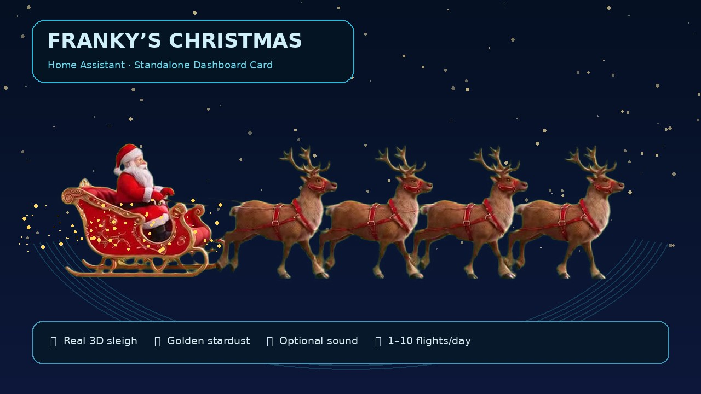

# 🎅 Franky's Christmas Card

**A cinematic Christmas sleigh that flies across your Home Assistant dashboard.**
Designed for **one monitor** — no helpers, automations, Browser Mod, or cloud accounts needed.

[](https://ko-fi.com/Frankys_Stuff)



[☕ Support Franky's Stuff on Ko-fi](https://ko-fi.com/Frankys_Stuff)

## What you get

- 🛷 Animated 3D Santa sleigh with reindeer, supplied as a transparent WebM
- ✨ Golden stardust trail
- 🎅 Santa's joyful **“Ho Ho Hooo”** and 🔔 gently jingling sleigh bells, both included
- 🎲 **1–10 randomly scheduled flights per day** between **09:00 and 22:00 by default**, or optional 1–2, 3–8, 5–10, 10–20 minute intervals
- 🕘 **Customizable daily flight hours** right in the card (start/end), applying to both schedule modes
- 📐 **Responsive card layout** with Home Assistant Sections drag-resizing, minimum usable button size, and a built-in **visual card editor**
- 🎛️ On/off, sound and instant **Test flight** controls, available even outside those hours
- 🌍 English and German, following Home Assistant's language
- 📺 Built-in illustrated fallback for browsers without transparent WebM support

## Install with HACS

1. Open **HACS** → **Custom repositories**.
2. Add `https://github.com/Franz1302/frankys-stuff-christmas-card` as a **Dashboard** repository.
3. Install **Franky's Christmas Card**.
4. Refresh Home Assistant, then **Edit dashboard → Add card**.
5. Choose **Franky's Christmas Card**, click **Test flight** and **Enable** when ready.

The video, iPad/Safari transparent animated WebP, and audio are installed together with the JavaScript from the repository's `dist/` folder. No extra files, helpers or automations to install.

### Minimal YAML

```yaml
type: custom:frankys-christmas-card
```

The card is initially **disabled** on each monitor. Enabling the card makes it run its own local schedule; **Sound on/off** controls its audio. Browsers may require one user interaction before they permit automatic sound playback.

**All dashboard views:** After opening the Christmas Card once on a display, its flight schedule continues on that display across Lovelace views, even when the card is no longer visible. The HACS dashboard resource restores the schedule after a page reload, including when another view is opened first. The dashboard must remain open; closing the browser stops flights. Each browser/display has its own local settings. On upgrading from an older version, open the control card once to register its configuration.

### Optional configuration

```yaml
type: custom:frankys-christmas-card
title: "Franky's Christmas"
duration: 10
width_percent: 60
sound_volume: 0.55
bells_volume: 0.78
layout_mode: auto # auto | compact | comfortable
schedule_start: "09:00"
schedule_end: "22:00"
```

Set `video`, `ios_video`, `sound`, `bells`, or `fallback` to a local `/local/` URL to override the bundled media. Set `video: false`, `sound: false` or `bells: false` to disable that asset individually.

## Visual editor and resizing

Choose **Edit dashboard → Franky's Christmas Card → Edit** to open the graphical editor. You can adjust the card title, layout density (**Auto**, **Compact** or **Comfortable**), daily start/end times, flight duration, sleigh size and separate sound volumes. Optional custom media URLs are in the advanced section.

In Home Assistant's **Sections** dashboard view, use the card's **Layout / size** controls to resize its width. The card advertises a default width of 12 grid columns and a minimum of 6 columns; its height automatically follows the number of wrapped controls. Buttons remain at least 44px high. In legacy Masonry dashboards, card width is controlled by the dashboard column rather than manually dragged.

All three visual styles automatically adapt to available space, including portrait tablets. The flying animation size (`width_percent`) is a **separate** setting from the card's width.

## Scheduling

The default selects a random integer from **1 to 10** and schedules that many flyovers between **09:00 and 22:00** in the browser's local time zone. Each user can change **From / Until** directly in the card, or provide `schedule_start` and `schedule_end` in YAML (24-hour `HH:MM`, start must be before end). The daily plan and preferences are kept **in each browser**. Visits missed while the dashboard is closed or hidden are skipped, not queued. Manual **Test flight** works at any hour and never uses the daily quota.

Selecting a minute interval replaces daily mode on that display, but **still respects the same start/end times**. Each enabled display has an independent schedule; this card deliberately does **not** synchronize your whole house.

## Compatibility

**Automatic device selection:** On iPad, iPhone and Safari, the card shows a transparent animated WebP (`sleigh-ipad.webp`) to avoid green edges. Other browsers continue using transparent WebM (`sleigh.webm`). No manual setting is needed. An older browser unable to render its preferred format falls back to an illustrated SVG. Custom video setups can override the iOS path with `ios_video:`. The original WebM is retained for non-Apple browsers. Autoplay sound may require interaction on browsers such as Silk and Safari.

## Installation without HACS

Copy all files from `dist/` into `/config/www/frankys-christmas-card/`. Register `/local/frankys-christmas-card/frankys-christmas-card.js` as a JavaScript module in Home Assistant's Dashboard Resources, and override the default paths:

```yaml
type: custom:frankys-christmas-card
video: /local/frankys-christmas-card/sleigh.webm
sound: /local/frankys-christmas-card/santa.mp3
bells: /local/frankys-christmas-card/bells.mp3
```

## Credits and license

**Code:** MIT © 2026 Franky's Stuff — see [LICENSE](LICENSE).

**Artwork:** The bundled sleigh animation was created and prepared for this project by the author. It is licensed for use as part of this project, not standalone resale or redistribution — see [ASSET_LICENSE.md](ASSET_LICENSE.md).

**Audio:** “Ho Ho Ho” by **cartoon_music** and “Bells Jingling 2” by **DRAGON-STUDIO**, used as part of this combined Christmas animation under the [Pixabay Content License](https://pixabay.com/service/terms/). The bells track has been gain-adjusted and blended in the animation. The sounds are included **only as components of this creative project**, not offered as independent sound-effect downloads, and are **not MIT-licensed**. Do not extract or redistribute either audio file on a standalone basis.

Feedback and issues: https://github.com/Franz1302/frankys-stuff-christmas-card/issues

☕ **[Thanks for the coffee! Support on Ko-fi](https://ko-fi.com/Frankys_Stuff)**

*Beta release — browser-specific feedback welcome.*